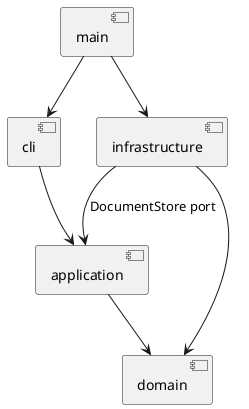

# Lab1 Phase 1：SVG 编辑器（CLI）

Git 仓库：<https://github.com/R-Morino/svg-editor-cli>

提交截止：2026-10-31 23:59（北京时间）；用户要求于 2026-10-30 完成。

## 架构方案（开发前基线）

| 模块 | 职责 | 允许依赖 |
| --- | --- | --- |
| `src/domain/` | 图形行为、组合树、不变量、工厂、快照克隆 | 仅自身与语言标准库 |
| `src/application/` | 命令、会话、历史、文件存储端口 | domain |
| `src/cli/` | 分词、命令注册与分发、REPL、输出 | application |
| `src/infrastructure/` | SVG XML 解析/序列化、原子文件写入 | domain、application 的存储端口、Node 和 XML 库 |
| `src/main.ts` | 装配依赖，启动 | 以上模块 |

CLI 不直接访问文件系统，领域不依赖 XML、终端或应用层。依赖方向用于隔离输入方式与文件格式变化。

组件图源文件：[architecture.puml](architecture.puml)。

### 设计模式

- **Command（必须）**：每个命令一个类；编辑命令保存执行前后文档快照，支持一条命令一次 undo/redo。提交快照前在草稿上执行，失败不改变文档或历史。
- **Composite**：抽象 Shape 统一 move/scale/set；Group 通过多态递归操作子树；SvgDocument 负责归属、顺序、全局 id 与防环不变量。
- **工厂**：ShapeFactory 是唯一图形类型名到实现的分派点，CLI 和 SVG 导入均复用。
- **端口/适配器**：DocumentStore 隔离同步文件 IO，测试可使用内存替身。
- 按名字分派仅允许 CommandDispatcher 和 ShapeFactory 两处；均标为**后续插件化待重构项**。Phase 1 不实现动态插件与 box。

### 变化点假设

1. 后续增加图形/box：保留 Shape 抽象与集中工厂；暂不实现插件加载、注册协议与复合类型元数据恢复。
2. 增加 GUI/agent 入口：应用命令不读终端；未来入口复用应用层。
3. SVG 解析/存储变化：通过 DocumentStore 和 SvgCodec 隔离；本阶段不实现网络存储。
4. 大文档撤销性能：先采用深拷贝快照保证事务正确性；成本为每次编辑 O(n) 时间与内存，未来再改为差量，不提前复杂化。

### 需求解释与边界

- 内置仅 rect/circle/ellipse/line/text/g，box 报 unknown shape type。
- 根级 g 禁止 ungroup，按任务书特殊规则执行。
- 同级顺序按 SVG 文档顺序；front 移到末尾（最后绘制），back 移到开头。
- group 按原文档深度优先顺序收编；同父时在首个选中节点处插入，跨父时挂根并在首个被选根分支处插入。祖先与子孙同时选择一律拒绝。
- 文档类成功后清空旧历史并设禁用屏障；下一次成功编辑解除屏障。失败命令（含 IO）不改变路径、文档或历史。
- canvas 无参数仅查询，不设置历史屏障；help 在无文档时也可使用，便于发现命令。
- 数字必须有限；几何尺寸和 stroke-width 非负，画布尺寸与 scale factor 正数。
- 外部 SVG 仅支持六种元素与数值几何属性；保留普通外观属性。transform 初步计划支持 translate 和等比 scale 并展开为几何坐标，其他变换明确报错，不静默丢弃。

## 过程记录

### 2026-10-30：需求与仓库准备

- 用户要求先阅读并解释任务书，再讨论协作和 Git 流程；用户自行创建空 GitHub 仓库并授权开始开发。
- 当前目录最初仅有 phase_cli_1.md，无 Git 仓库；已确认 Node.js 24.18.0、npm 11.16.0、Git 2.53.0。
- 普通沙箱中 Git 网络连接失败；使用获准的网络执行方式确认远程为空。不能把本地提交当成远程推送成功。
- 此次实现与自查由 AI 执行；不将 AI 发现的问题写成用户亲自审查的成果。
- 本提交先保存需求解释和架构基线，再进入代码实现。

## 一致性自查

待实现后以实际目录与 import 检查结果填写。

## 质量保证手段

计划：TypeScript 严格检查、领域及命令测试、真实临时文件 round-trip、任务书案例脚本、CLI 子进程测试、模块依赖自动检查。验收结果待实际执行后填写。

### 2026-10-30：图形模型阶段

- 六种图形、组合树、唯一 id、防环、层级顺序和深克隆已实现。严格类型检查和 5 项领域测试通过；尚未实现 CLI 与文件 IO。
- 纠正风险：跨父分组必须先校验所有成员与祖先关系，再摘出节点；按文档顺序收编，避免参数顺序意外改变 z-order。

