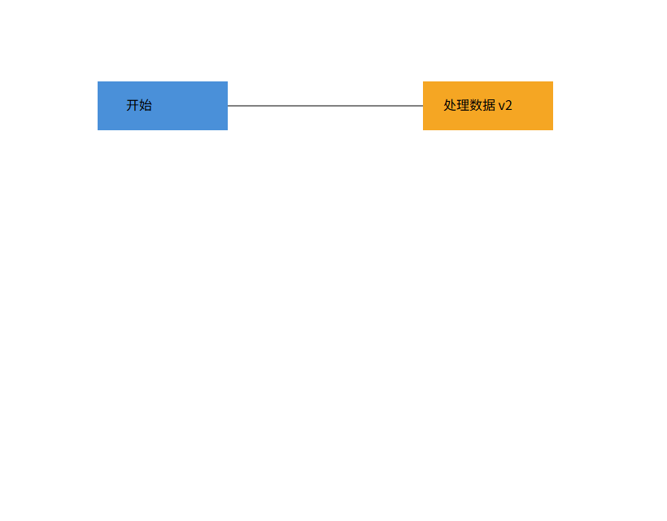
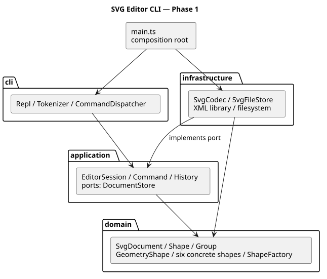

# Lab1 Phase 1：SVG 编辑器（CLI）

**Git 仓库：<https://github.com/R-Morino/svg-editor-cli>**

最终版本：[final 标签](https://github.com/R-Morino/svg-editor-cli/tree/final)

任务依据：[phase_cli_1.md](../phase_cli_1.md)

这是一个基于 TypeScript 的面向对象 SVG 命令行编辑器，支持六种内置图形、组合树、图形编辑、SVG 读写和命令级撤销重做。`box` 和动态插件属于后续阶段。

## 运行与验收入口

推荐 Node.js 24；工程声明支持 Node.js 22 及以上，已实际验证 Node.js 24。依赖版本由 `package-lock.json` 固定，不需要全局安装 TypeScript。

```powershell
git clone https://github.com/R-Morino/svg-editor-cli.git
cd svg-editor-cli
git checkout final
npm ci
npm run cli
```

在 `svg>` 后输入命令；Windows 结束输入可按 Ctrl+Z 再回车，macOS/Linux 可按 Ctrl+D。

```text
init 800 600
create g scene
create rect r1 10 20 100 50 #4a90d9 in scene
create text t1 25 50 "Hello SVG" in scene
move scene 20 10
undo
tree
save demo.svg
```

SVG 可直接用浏览器打开。完整命令语法见 `help`，包括 `create` 六种类型的参数。

PowerShell 回放附件的流程图案例：

```powershell
Get-Content -Encoding utf8 examples/flowchart.commands | npm run cli
Start-Process examples/flowchart.svg
```

若使用旧版 Windows PowerShell，中文管道出现乱码时，建议使用 PowerShell 7，或先设置 `$OutputEncoding = [System.Text.UTF8Encoding]::new()`。

其他平台可使用 `npm run cli < examples/flowchart.commands`。

所有操作均相对于**启动进程时的工作目录**。带空格路径使用双引号；也支持 Windows 路径。`#` 只在一行首个非空白字符处表示注释，因此颜色值 `#4a90d9` 不会被截断。双引号参数支持空字符串、`\"` 和 `\\` 转义。

管道模式不打印交互提示符；若脚本中出现任何错误，仍继续执行后续行，但最终退出码为 1。`examples/session.commands` 忠实保留附件中的两条预期错误，退出 1 是该案例的正常结果。



图中内容来自实际执行 [flowchart.commands](../examples/flowchart.commands) 后生成的 [flowchart.svg](../examples/flowchart.svg)，由本机 Chrome 截图核验。

## 架构方案

### 模块划分与职责

```text
src/
  main.ts                 装配依赖，启动 REPL
  cli/                    终端适配、分词、命令分发
  application/
    commands/             19 个命令类
    Command.ts            命令接口
    EditCommand.ts        编辑事务与前后快照
    EditorSession.ts      当前文档、文件路径、会话操作
    History.ts            撤销/重做栈与 IO 屏障
    DocumentStore.ts      文件存储端口
    DocumentView.ts       tree/show 的文本视图
  domain/                 图形行为、组合树、不变量、工厂
  infrastructure/         XML 编解码与真实文件存储
test/                     领域、命令、IO、CLI 测试
scripts/                  架构静态检查
examples/                 附件案例、回放脚本、SVG 输出
doc/                      本提交文档、架构图、验证证据
```



可编辑图源：[architecture.puml](architecture.puml)。图片由该 PlantUML 源文件实际渲染，已在浏览器检查可读性。

| 模块           | 主要职责                                        | 关键实现                                                                                       |
| -------------- | ----------------------------------------------- | ---------------------------------------------------------------------------------------------- |
| domain         | 封装图形属性、坐标操作、全局 id、归属和层级顺序 | `Shape`、`GeometryShape`、`Rect/Circle/Ellipse/Line/Text/Group`、`SvgDocument`、`ShapeFactory` |
| application    | 执行用例，协调文档、历史与存储端口              | `Command`、`SessionCommand`、`EditCommand`、各具体命令、`EditorSession`、`History`             |
| cli            | 解析终端文本，选择命令并展示结果                | `Tokenizer`、`CommandDispatcher`、`Repl`                                                       |
| infrastructure | XML DOM 与领域模型转换，读取和原子保存文件      | `SvgCodec`、`SvgFileStore`                                                                     |
| main           | 注入真实存储并连接 stdin/stdout                 | `src/main.ts`                                                                                  |

### 设计模式的选择与落地

**Command（任务书必须项）**：每个命令一个类，通过 `Command.execute()` 执行；编辑命令共同继承 `EditCommand` 并实现领域操作 `apply(document)`。`UndoableCommand` 定义 `undo/redo`，`History` 维护两个栈。

一条编辑命令的执行流程为：

1. 克隆当前文档，得到执行前快照与可写草稿。
2. 在草稿上检查参数并执行领域操作。
3. 成功后保存执行后快照，替换会话文档并记录该命令；失败时丢弃草稿。
4. undo/redo 恢复相应快照；下一次成功编辑清空 redo 栈。

因此，`group g1 r1 c1 t1` 整体只有一个撤销单元；递归缩放中某个后代发生数值溢出时，前面已经改动的草稿节点也不会泄漏到当前文档。失败的输入、编辑和 IO 均不破坏已有 redo。

成功执行 init/read/save/canvas 修改尺寸后，历史清空并设 IO 屏障，undo 和 redo 均输出 `error: undo not allowed after io command`。下一条成功编辑解除屏障，但不会恢复 IO 之前的旧历史。canvas 查询及 tree/show/help 不进入历史。

**Composite**：`Shape` 统一定义 move/scale/set、children、clone 和显示行为。`Group` 递归调用子节点的 move/scale；叶子由 `GeometryShape` 处理各自的数值几何属性。命令层无需针对 rect/circle/g 分别编写分支。对 g 设置 fill/stroke/stroke-width 会成为 SVG 的继承属性；不会把同一个值强行覆盖到已有显式样式的子节点。

**工厂**：`ShapeFactory` 集中映射六种类型名到具体类；CLI create 与 SVG 导入共用该工厂。图形属性是私有字段，经方法校验修改；返回的 attributes/children/geometry 均为副本。

**存储端口与适配器**：`EditorSession` 只知道 `DocumentStore`，不访问 fs 或 DOM。`SvgFileStore` 实现该端口，使用同目录临时文件再 rename，避免直接覆盖时留下半个 SVG。命令测试可注入内存存储。

### 依赖方向规则

| 来源           | 允许依赖                                                                        | 理由                                         |
| -------------- | ------------------------------------------------------------------------------- | -------------------------------------------- |
| domain         | domain 与语言标准库                                                             | 核心图形行为不受终端、XML 或文件系统变化影响 |
| application    | application、domain                                                             | 用例协调领域并定义外部端口                   |
| cli            | cli、application，以及 Node readline/stream                                     | 终端只负责输入输出适配                       |
| infrastructure | infrastructure、domain、application 的 `DocumentStore` 端口、Node API 与 XML 库 | 外层实现内层端口，负责技术细节               |
| main           | 上述模块                                                                        | 仅在装配入口选择具体适配器                   |

违反以上规则的 import 都是待处理项。`npm run check:architecture` 通过 TypeScript AST 检查实际 import；同时检查一类一文件、类名匹配文件名、无顶层过程式函数，以及 switch 出现位置。它不能自动证明所有设计行为正确，仍需人工抽样和功能测试。

按名字选择实现只有两处，均保留明确 TODO，并标为**后续插件化待重构项**：

- `cli/CommandDispatcher.ts`：命令名 → 命令构造器。
- `domain/ShapeFactory.ts`：图形类型名 → 图形构造器及参数定义。

其余图形操作依靠多态；属性白名单判断和 XML 节点种类判断不承担图形类型分发。

### 变化点假设

| 预计变化               | 当前预留                                | 本阶段决定不实现及理由                                                      |
| ---------------------- | --------------------------------------- | --------------------------------------------------------------------------- |
| 增加图形与 box 插件    | Shape 抽象、集中工厂、组合树            | 动态注册、插件加载和 data-kind 恢复协议留待后续阶段，避免超出作业范围       |
| 增加 GUI 或 agent 入口 | 命令与会话不读取终端                    | 暂不做 GUI、HTTP 或 agent 服务                                              |
| 更换 XML 库或文件存储  | SvgCodec 与 DocumentStore               | 暂不做远程存储、通用 SVG 渲染器                                             |
| 大文档撤销性能         | 所有历史封装在 EditCommand/History      | 使用全量快照优先保证事务正确性，单次编辑 O(n)、历史 O(kn)；以后可替换为差量 |
| 更丰富的变换与路径图形 | 导入后保留原生 transform 和普通外观属性 | 不做变换矩阵求逆、全局坐标重定位，也不支持 path 等额外元素                  |

### 明确的实现约定与边界

- id 必须非空、无空白，唯一且区分大小写；不通过 set 修改 id。导入时先预留全文显式 id，再按类型名与最小可用序号分配，防止与后面出现的 id 冲突。
- 六种内置类型及所有 create 的 `in` 后缀均支持。create/group 的 id 必填；box 和其他类型按任务书输出 unknown shape type。
- 坐标及尺寸必须为有限数；位置可为负，几何尺寸和 stroke-width 非负，画布尺寸及 scale factor 正数。scale 同乘位置与尺寸，不改 stroke-width 或文字字号。
- 省略 fill/stroke 时不写出该属性，遵循 SVG 默认或继承；不自动给 line 补描边。
- set 只允许任务书白名单；text 内容作为 XML 子文本，使用 DOM 自动转义，支持中文、空字符串与特殊字符。
- 同级最后一个节点最后绘制，因此 front 移到末尾，back 移到开头，均只改变同级顺序。
- group 采用原文档深度优先顺序收编。同父时新组插在第一个选中节点处；跨父时新组挂到根，在第一个被选根分支处插入。祖先和子孙同时被选以及循环 addto 均拒绝。
- 按任务书特殊规则，根级 g 禁止 ungroup；嵌套 g 解散后，子节点占据原组位置。
- init 支持 0/1/2 个尺寸参数，缺省宽 800、高 600；canvas 只给宽度时保留当前高度，查询不设历史屏障。
- save 无参使用最近一次成功 read/save 的路径；init 清除路径，首次保存需显式给出文件名。失败 IO 不更新默认路径。
- help 作为使用说明，在无文档时也可运行；其他需要当前文档的命令输出任务书指定错误。
- 外部 SVG 支持六种元素、数值几何属性，画布宽高支持纯数字和 px；保留 viewBox、transform、font-size、text-anchor、style 等普通属性。transform 由浏览器渲染，move/scale 修改元素自身的局部数值坐标；不保证跨变换容器重新归属后屏幕位置不变。
- 未支持的元素（如 path/defs/tspan）、非 SVG 命名空间、DOCTYPE、事件属性及不合法 XML 会明确报错；不静默删掉这些内容。没有声称支持完整 SVG 标准。

## 过程记录

我主要负责提出需求、创建仓库和审阅文档，agent 负责代码实现、测试执行及问题修复。以下记录我与 agent 协作中的关键讨论和迭代过程，开发提交均真实产生并逐次推送。

### 1. 需求理解与架构先行

我先要求 agent 阅读附件并解释作业要求，再询问协作方式及 Git 流程；随后创建 GitHub 空仓库，提供截止时间。agent 将附件整理为模块规则与明确的语义约定，先提交架构文档，再开始代码实现。

项目初始目录只有任务书，没有 Git 仓库。agent 检查开发环境，确认本机使用 Node.js 24.18.0、npm 11.16.0、Git 2.53.0。普通沙箱访问本机代理失败，获准在具备网络访问的执行环境中操作后，agent 将阶段提交推送到我提供的仓库，并逐次核对推送命令的结果。

### 2. 图形模型与命令事务

我委托 agent 分阶段实现编辑器。agent 先实现六种图形、组合树、唯一 id、防环、排序和深拷贝，5 项领域测试通过后提交；再实现 19 个命令、分词和历史，13 项测试通过后提交。

在实现过程中，agent 的自查聚焦两个风险：group 不能在验证完所有成员前逐个摘除；undo 后的失败命令不能误清 redo。agent 因此采用草稿事务，并用祖先交叠分组、缺失成员、非法尺寸和递归数值溢出等测试验证。我将这些问题及其验证方式纳入协作过程记录。

### 3. SVG 与真实文件验证

在 SVG 读写实现中，agent 在导入前扫描全文 id，避免无名 rect 被分配为 rect1 后与后面的显式 rect1 冲突。agent 执行读写测试，验证 XML 特殊字符、中文、嵌套顺序、原生变换、文件默认路径与失败 IO 的历史保持。

根据 agent 的实际测试记录，Windows 沙箱临时目录可以写入，但 rename 返回 EPERM；工程内临时目录可以完成原子保存。agent 将测试临时文件改放 `.tmp/tests/`，删除前验证绝对路径仍在测试目录内，并保留原子保存逻辑。我在报告中保留这一环境问题及其处理依据。

### 4. 修订外部 transform 处理方案

agent 在开发前的架构基线中初步考虑将 translate/scale 展开为几何坐标。实现过程中的自查发现，这会影响继承字号和描边的外观，且完整处理需要矩阵与样式计算，超出阶段目标。agent 随后改为保留原生 transform、编辑局部几何坐标，并通过 round-trip 测试确认 transform 和文本样式未丢失。我将这次调整记录为方案修订，并在上文保留相应边界说明。

### 5. 工具兼容与交互结束修复

根据 agent 的执行记录，初次安装的 TypeScript 7.0.2 包未提供架构检查所需的 createSourceFile 等 Compiler API。agent 根据实际类型错误改为固定 TypeScript 5.9.3，并把 Node 类型与本机 Node 24 对齐。

agent 增加交互输入测试后发现：多行输入已经缓冲且 readline 收到 EOF 时，执行完命令继续 prompt 会触发 ERR_USE_AFTER_CLOSE。agent 通过监听 close 修复该问题，在输入关闭后不再刷新提示符，并确认新增回归测试通过。我在开发历史中保留了对应的独立修复提交。

我在报告中保留架构图源文件和实际渲染结果。agent 在渲染时修正了初稿的单行 package 语法以及包名与组件别名冲突，并在浏览器中核验最终图像。

### 6. 开发历史与证据

我按开发阶段整理了以下提交与验证记录，其中代码实现、测试执行和推送操作由 agent 完成。

| 提交      | 内容                              | 当时验证                               |
| --------- | --------------------------------- | -------------------------------------- |
| `86323c6` | 需求解释与架构基线                | 确认空仓库，首次推送成功               |
| `6cc0abd` | 图形与 Composite 文档模型         | 严格类型检查，5 项领域测试             |
| `3e04cbc` | 命令、事务、撤销重做              | 13 项累计测试                          |
| `b626a95` | SVG IO、REPL、案例、架构检查与 CI | 22 项测试、构建，Windows/Linux CI 成功 |
| `115bbed` | 修复输入结束时提示符错误          | 新增交互回归测试，累计 23 项通过       |
| 后续提交  | 统一格式、完成最终文档与证据      | 格式、类型、23 项测试、依赖检查和构建  |

完整历史可在 [GitHub commits](https://github.com/R-Morino/svg-editor-cli/commits/main/) 查看。`final` 标签用于固定最终交付提交，标签和分支均单独推送并核对。

## 一致性自查

我依据 agent 执行的静态检查和依赖抽样记录，对照架构方案整理如下自查结果。

### 模块划分是否与方案一致

一致。实际有 cli/application/domain/infrastructure 四个模块，`main.ts` 负责装配；application 中增加 commands 子目录以满足一类一文件，属于基线内部细分。额外的 test/scripts/examples/doc 均为测试、检查和交付资产。

我在过程记录中列出了以下方案修订：transform 从预期展开改为原生保留，TypeScript 工具版本固定，图源修正后补充实际渲染图。根据 agent 的实现记录，没有未记录的模块合并或职责迁移。

### 依赖方向是否被违反

根据 agent 执行的自动检查记录：**44 个源 TypeScript 文件、110 条 import，未发现违反既定模块规则的依赖**。

agent 执行的依赖抽样检查如下：

- `MoveCommand` 通过 `SvgDocument.find()` 获得 Shape 后调用多态 move，不依赖 XML、终端或具体图形类。
- `EditorSession` 依赖领域、History 与 DocumentStore 接口，不依赖 SvgFileStore 或 fs。
- `SvgFileStore` 只依赖 DocumentStore 端口、领域类型、SvgCodec 和 Node 文件 API。
- `Group` 仅依赖 Shape/Numeric，递归调用图形行为，不反向依赖命令。
- `CommandDispatcher` 负责名字分发，未在其他命令中复制图形类型分发。

当前已知待重构项是两处内置注册与全量快照性能，均已在方案中明确；未发现尚未处理的依赖违规。

## 质量保证手段

我的验收依据包括自动化测试、严格类型检查、架构静态检查、构建结果、案例回放及浏览器截图。以下测试运行、构建和浏览器截图核验均由 agent 执行，我据其输出记录整理功能覆盖与已知限制。

### 可复现检查

```powershell
npm ci
npm run check
npm run build
```

`check` 顺序执行 Prettier 格式检查、TypeScript strict 类型检查、Node 测试以及 AST 架构检查。构建结果可通过 `node dist/src/main.js` 运行。

本机完整结果见 [verification.txt](verification.txt)，案例实际输出见 [flowchart-transcript.txt](flowchart-transcript.txt) 和 [session-transcript.txt](session-transcript.txt)。

### 功能与测试覆盖对照

| 验收项目                                     | 验证方式                                          |
| -------------------------------------------- | ------------------------------------------------- |
| 六种图形、默认外观、唯一且区分大小写的 id    | domain.test.ts；commands.test.ts                  |
| init/read/save/canvas 及默认路径             | commands.test.ts；io.test.ts                      |
| create 与所有类型的 in、非法容器及未知类型   | commands.test.ts；domain.test.ts；流程图回放      |
| move/scale/set 的叶子与容器统一操作          | domain.test.ts；commands.test.ts，含递归溢出回滚  |
| group、ungroup、addto、防环、同级 front/back | domain.test.ts；commands.test.ts                  |
| delete 子树与单命令 undo/redo                | commands.test.ts；附件典型会话子进程测试          |
| redo 清空、IO 屏障、失败不改变状态           | commands.test.ts；io.test.ts                      |
| tree/show/help、内联几何属性、注释和双引号   | commands.test.ts；cli.test.ts                     |
| 缺 id 警告、编号避让、XML round-trip         | io.test.ts                                        |
| 真实文件原子覆盖、失败读写不改变路径与历史   | io.test.ts，在工程临时目录实际读写                |
| 交互 svg>、管道输入、错误后继续执行、退出码  | cli.test.ts，含真实 Node 子进程与交互流模拟       |
| 架构目录、import、一类一文件与分派位置       | ArchitectureCheck.ts 及 agent 执行的依赖抽样检查  |
| 浏览器实际显示                               | flowchart.svg 与 agent 使用本机 Chrome 生成的截图 |

根据 agent 保存的验证记录，最终本地 **23 项测试全部通过**，格式、严格类型、架构检查与构建均通过。agent 也确认早期已推送实现的 [Windows/Linux CI](https://github.com/R-Morino/svg-editor-cli/actions/runs/41043115497) 成功；最终提交的远程结果以 [Actions 页面](https://github.com/R-Morino/svg-editor-cli/actions) 中对应提交为准。

已知限制是全量快照成本、有限的 SVG 元素子集以及导入 transform 下的局部坐标语义；未声称测试覆盖完整 SVG 标准、所有平台或超大文档性能。

### 外部技术资料

- XML DOM API 依据 [xmldom 官方项目说明](https://github.com/xmldom/xmldom)，解析错误处理同时核对实际安装版本的类型声明。
- 架构扫描使用 [TypeScript 官方 Compiler API](https://github.com/microsoft/TypeScript/wiki/Using-the-Compiler-API)。
- 架构图保留 [PlantUML](https://plantuml.com/) 源文件和已渲染 SVG，避免 Markdown 平台不支持 PlantUML 代码块时无法查看。
